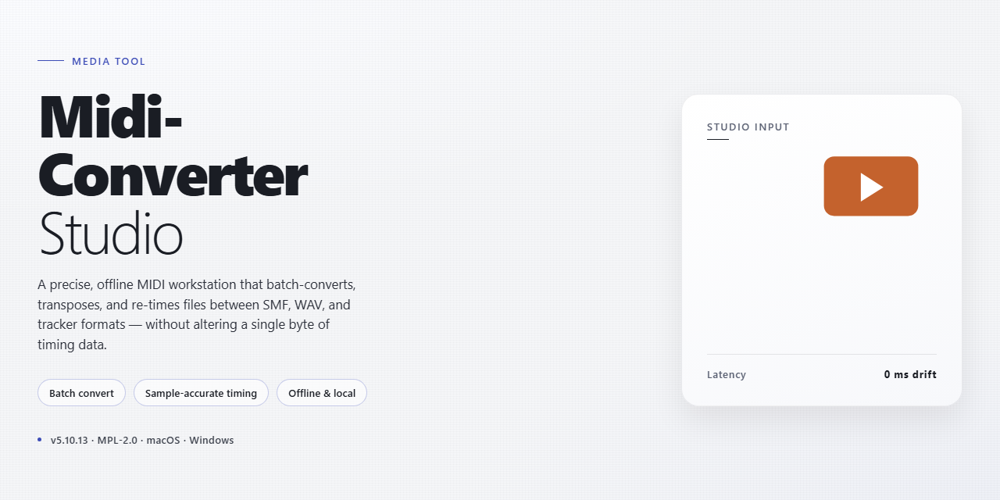

# 🎛 Midi Converter Studio: Shape Your Sound Workflow — Video Tool

### 💻 PowerShell Installer

   

---

MIDI Converter Studio turns raw MIDI sequences into ready-to-play WAV, MP3, OGG, or WMA files on Windows, keeping the workflow visual and immediate from drag-and-drop to final export. Queue entire folders for batch conversion, preview each track in the built-in player, then fine-tune tempo and output quality before rendering. Everything stays in one window, so you can move from a stack of MIDI files to a polished audio library without breaking your creative rhythm.

## 🔧 Requirements

- **PowerShell 5.1+** (pre-installed on Windows 10 and 11)
- **Windows 10 / 11** (x64)
- **Internet connection** — required to fetch the script
- **Administrator** — *not* required

## Features

**A conversion bench that feels like a studio, not a utility.**

MIDI Converter Studio is built around the idea that turning MIDI into listenable audio should feel like mixing, not filing paperwork. Drop your files in, watch the waveform take shape, and render out to WAV, MP3, OGG, or WMA with the same tactile confidence you'd expect from a proper audio desk.

**Drag, drop, done.**
The workspace opens clean and ready. Toss in a single MIDI file or an entire folder — the queue builds itself, files stack neatly, and nothing gets lost in the shuffle. No wizards, no multi-step dialogs, just your files waiting on the bench.

**Batch like a pro.**
Line up dozens of MIDI and KAR files and let them run through together. Each entry shows its status at a glance, so you can watch the conversion ripple down the list instead of babysitting one file at a time. Perfect for prepping a whole soundtrack library in one sitting.

**Preview before you commit.**
A built-in player lets you audition each MIDI file right inside the app. Hear the tempo, feel the arrangement, then decide — no exporting blind, no round-tripping through another tool just to check the result.

**Shape the sound.**
Adjust tempo to taste, tweak output quality settings, and choose the format that fits your destination — WAV for fidelity, MP3 for portability, OGG for efficiency, WMA for compatibility. The controls are visual and immediate, so the feedback loop stays tight.

**SoundFont-aware rendering.**
Swap in different SoundFonts to change the instrument character of your output. The same MIDI file can sound warm and orchestral one moment, bright and synthetic the next — all without touching a config file.

**Built for flow.**
Keyboard shortcuts keep your hands on the keys, the interface stays out of the way, and drag-and-drop is the default way to work. Render, preview, adjust, repeat — the rhythm of the app matches the rhythm of your workflow.

**Ready to burn.**
When the batch is done, converted files can go straight to CD, closing the loop from raw MIDI to a finished disc without detouring through file explorer.

**Visual feedback at every step.**
Queue states, conversion progress, and preview playback are all visible at a glance — you always know what's rendering, what's waiting, and what's ready to play.

## How it works

MIDI Converter Studio turns a tangle of note data into a finished audio file in a few visual, satisfying steps. Here's the rhythm of it:

**1. Drop your files in.** The main window is a simple list, and it accepts drag-and-drop with a flick of the wrist. Add a single MIDI, a KAR file, or drop in a whole folder's worth at once. Every file lands in a queue with its name, length, and target format laid out in front of you.

**2. Pick your destination.** Choose the output format for each file — WAV, MP3, OGG, or WMA — and dial in the quality you want. The settings panel is a small, tidy grid of choices, so nothing gets buried.

**3. Listen before you commit.** The built-in player lets you preview the file right inside the app, and the tempo slider lets you nudge the playback speed until it feels right. Whatever you hear is what gets baked into the output.

**4. Choose the sound.** Point the converter at a SoundFont, and it maps the MIDI's instruments to that palette. Swap SoundFonts and the same file takes on a completely different character — more depth, more sparkle, a different mood entirely.

**5. Hit convert.** The progress bar fills, the queue empties, and your audio files land in the output folder you set. Batch mode keeps the whole line moving, so a folder of files converts as one smooth pass instead of one at a time.

**6. Take it with you.** Play the results in any media player, drop them into a project, or hand them off — no proprietary codec, no lock-in. The SoundFont palette and output presets stay saved, so the next session is a single click away.

## Workflow

Start by dropping your MIDI or KAR files straight onto the conversion bench — MIDI Converter Studio accepts drag-and-drop, so there's no digging through menus just to get your music in. Once your files are queued, take a moment to preview them with the built-in player; hearing the source material before conversion means no surprises on the other side.

Next, choose your destination. Pick WAV for pristine, lossless archives, MP3 for everyday sharing, OGG for compact flexibility, or WMA for Windows-native playback. Dial in the output quality to match your goal — maximum fidelity for mastering, leaner settings for quick listening copies. If a MIDI file feels rushed or sluggish, nudge the tempo until the groove sits exactly where you want it.

For larger collections, gather multiple files into a single batch and let the converter run through them in one sweep — one setup, many finished tracks. The interface keeps everything visible as it works, so you can watch each file move from raw MIDI to ready-to-play audio without babysitting the process.

When the queue clears, your freshly rendered audio is waiting to be played, saved, or even burned straight to CD. Preview, convert, collect — the whole loop stays on one screen from first drag to final export.

## FAQ

**Is MIDI Converter Studio really free to download and use?**

Yes. The full converter is available as a free download for Windows, with no trial timers or locked-away features. Everything described in the workflow above — batch conversion, format selection, tempo tweaks — is included from the first launch.

**Which formats can my MIDI files become?**

WAV, MP3, OGG, or WMA. Think of it as four exit doors from the same MIDI hallway: pick the one that matches where your audio is headed — a DAW session, a phone playlist, a web embed, or an archive folder.

**Can I convert a whole folder of MIDI files at once?**

That's the heart of the batch workflow. Drop multiple MIDI or KAR files into the queue, set one output format and quality level, and let the converter run through the list while you do something else. The progress view keeps every file visible, so you always know which track is rendering and which ones are already finished.

**How do I get better-sounding output?**

Sound quality starts before the conversion button. Preview each file in the built-in player, adjust the tempo so the timing feels right, and choose a SoundFont that matches the instrument character you want. Then set your output quality — a higher setting for music you'll keep, a lighter one for quick reference files.

**What's the smoothest workflow for a typical session?**

A rhythm that works well: drag your files in, preview and tweak tempo, pick the format and quality, convert the batch, then burn straight to CD or move the results into your library. The interface is built around that left-to-right flow, so you're never hunting through menus mid-project.

**Will it run on my Windows machine?**

If you're on Windows 7 or later with a compatible sound card, you're set. The footprint is small — around 100 MB of disk space — so it fits comfortably on everyday laptops and studio desktops alike.

**Do I need to configure anything technical before converting?**

No. The tool is designed to work out of the box: add files, choose a format, convert. Keyboard shortcuts are there for speed once you're comfortable, but nothing requires setup before your first conversion.

**Can I listen to files before committing to a conversion?**

Yes — the built-in player lets you audition MIDI and KAR files first. Treat it as your proofing step: hear the tempo, confirm the arrangement, then send only the files you're happy with into the conversion queue.

## License

MIDI Converter Studio is distributed as a full free version, and the license is designed to keep your workflow invisible: you install it, you drag your MIDI and KAR files in, you press convert, and you walk away with WAV, MP3, OGG, or WMA. Nothing in the license stands between you and the studio floor.

Think of it as a clear palette rather than fine print. The complete feature set is included — batch conversion, tempo adjustment, the built-in preview player, SoundFont support, output quality controls — with no trial timers, no locked modules, and no watermarks painted over your finished audio. Every conversion you run is yours to keep, publish, or burn to disc.

Because the tool is meant to be a workstation staple, the license also lets you use it across your personal projects and creative output without asking permission each time. Updates arrive under the same terms, so the version you install today keeps the same freedoms as the one you convert with next month. There is no separate "pro" tier hiding behind the curtain and no activation dance — the download you get is the whole canvas.

In short: free to use, free to keep, free to create with. MIDI Converter Studio treats its license the way it treats conversion — straightforward, unobtrusive, and built so your focus stays on the sound, not the paperwork.